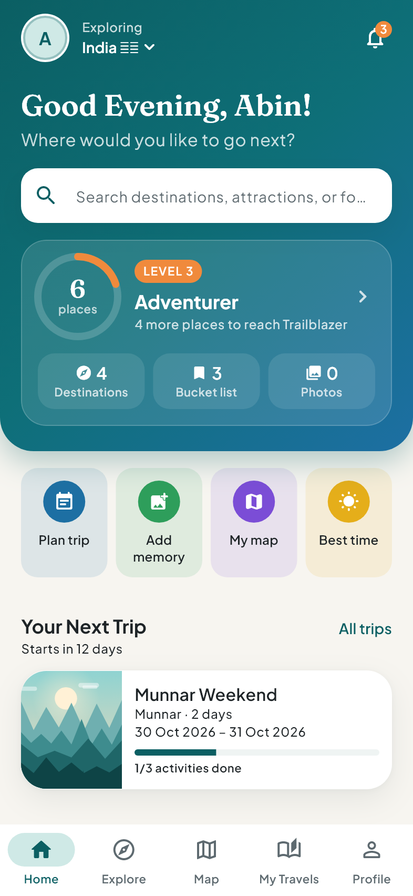
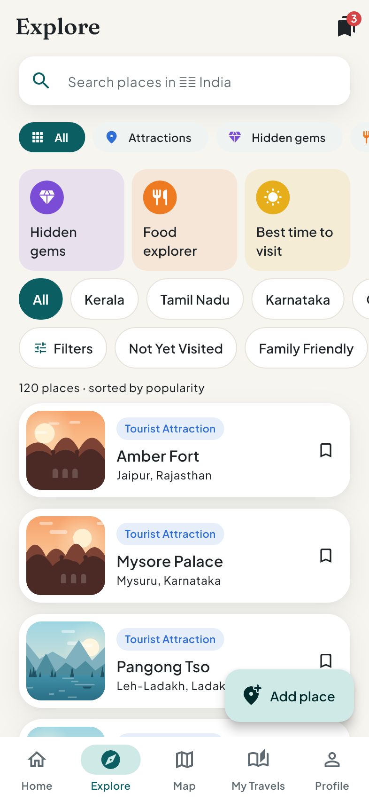
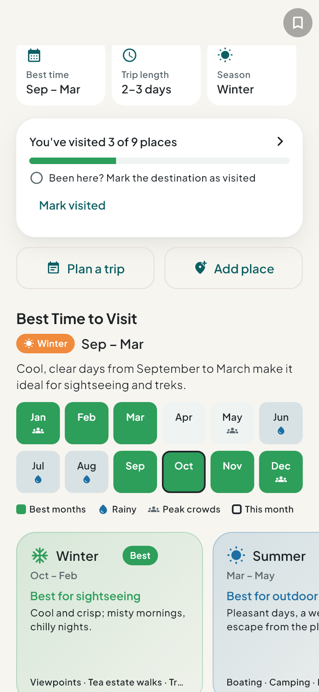
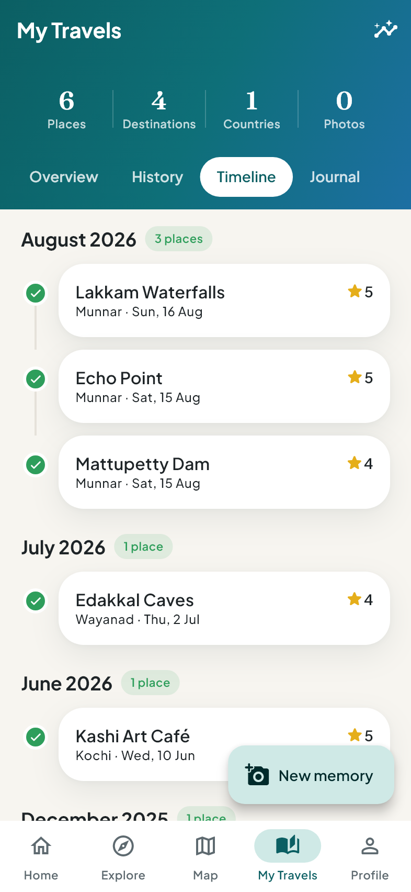
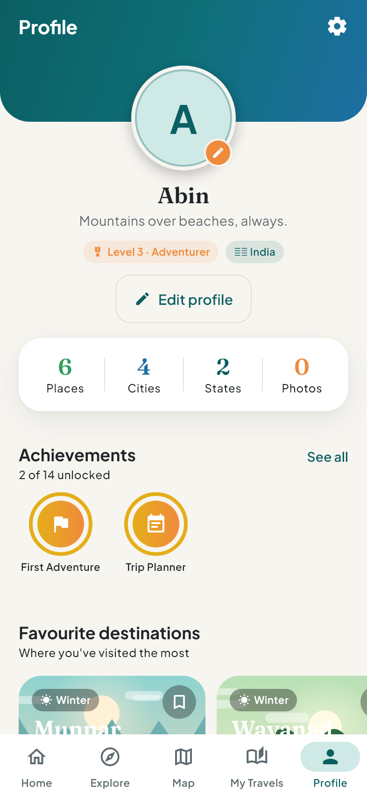

# Travel Explorer

**Discover, explore and track your adventures.** A Flutter app that combines a
destination guide, a personal travel journal and a trip planner — fully
offline, with no account, API key or backend required.


-F5A623)

<p align="center">
  
  
  
  
  
</p>
<p align="center"><sub>Home · Explore · Best time to visit · My Travels · Profile</sub></p>

## Highlights

- **Personal home dashboard** — explorer level and progress, your next trip with a
  countdown, recent memories and a bucket-list preview.
- **Explore** — search every place in a country, narrow by type (attractions,
  hidden gems, food spots, saved), filter, sort and bookmark favourites.
- **Destination guides** — intro and history (from Wikipedia), a 12-month
  best-time strip (best, rainy, peak crowds), season cards, attractions, food.
- **My Travels** — places, destinations and countries visited; a photo wall,
  history by state and city, a timeline with ratings, and a memory journal.
- **Your own map** — only the places you've been (shown with your memory photos)
  and your bucket list; tap a place to see its photos and every memory.
- **Trip planner** — day-by-day plans with attractions, food and custom items.
- **Achievements & analytics** — 14 computed badges and charts by state,
  category and month.
- **Private by design** — everything is stored on the device.

## Running

```bash
flutter pub get
flutter run            # Android or iOS device / emulator
flutter test           # unit + widget tests (incl. a layout audit at 5 screen sizes)
flutter build apk      # release Android build
```

Flutter 3.47 / Dart 3.13. Targets Android and iOS.

## What works

| Area | Status |
|---|---|
| Country selection (India default, searchable, flags, saved) | ✅ |
| Home: greeting, search, explorer level & stats, quick actions, next trip, recent memories, bucket-list preview, browse by state | ✅ |
| Explore: live search, type chips (attractions / hidden gems / food spots / saved), filters, sort, bookmarks, guide shortcuts | ✅ |
| Country → State → Destination → Place hierarchy, any country | ✅ |
| Destination page: intro, best time, month strip, season cards, climate, attractions with filters & sort, gems, food, dishes, activities, map | ✅ |
| Attraction page: details, mark visited (date + rating, edit/remove), bucket list, map, directions, photos, notes, memories | ✅ |
| Search across states, destinations, places, dishes | ✅ |
| Filters: popular, hidden gems, nature, adventure, historical, religious, family friendly, free/paid, visited/not visited; sort by popularity, name, distance from centre | ✅ |
| My Travels: collapsing stats header, photo wall, statistics, history (country → state → city), timeline with photos & ratings, journal | ✅ |
| Memories: multiple photos (gallery/camera), title, date, notes, rating, edit, delete, full-screen viewer | ✅ |
| Hidden gems section + Add New Place (map pin, categories, photos, tips…) — edit & delete | ✅ |
| Food Explorer: categories, regions, food spots, must-try dishes, "Foods I want to try" with tried ticks | ✅ |
| Best Time to Visit: pick a month, see which destinations suit it | ✅ |
| Map (OpenStreetMap): places you've visited (with memory-photo markers) and your bucket list; photo strip and all memories per place; directions | ✅ |
| Bucket list: places & destinations, filter by country/state, tick off as visited (updates stats), saved food spots | ✅ |
| Trip planner: create/edit, days, add attractions/food/custom items, reorder, move between days, complete items | ✅ |
| Analytics: totals, places by state, by category, monthly activity; 14 computed achievements | ✅ |
| Profile & settings: cover and avatar, level badge, stats, name, photo, bio, theme (system/light/dark), notification prefs, privacy, clear data, about | ✅ |
| Local persistence of everything (survives restarts) | ✅ |

## Architecture

```
lib/
  main.dart / app.dart        bootstrap: open storage, ProviderScope, MaterialApp.router
  core/
    theme/                    design tokens: colours, spacing, radii, typography, ThemeData
    widgets/                  component library: cards, chips, search, skeletons, empty states,
                              photo grid/viewer, scene artwork, stat tiles, dialogs…
    router/                   GoRouter config, bottom-nav shell, route constants
    utils/                    labels/formatting, directions launcher
  domain/
    entities/                 pure models (catalog data and user activity kept separate)
    repositories/             interfaces: CatalogRepository, EntityStore<T>, ValueStore<T>
  data/
    mock/                     bundled sample catalog (countries, regions, destinations, places, dishes)
    repositories/             BundledCatalogRepository, Hive-backed stores
    services/                 PhotoStorage, WeatherService & MapTileConfig integration seams
  application/                Riverpod providers: catalog index, user-data notifiers,
                              derived stats / history / timeline / achievements / notices
  features/<feature>/         screens and feature widgets (explore, places, food, map,
                              travels, bucket, trips, profile, onboarding)
```

- **State**: Riverpod (`Notifier`/`Provider`, no code generation). UI reads
  providers; business rules (visit/memory relationships, stats, filtering) live in
  `application/` and `features/explore/place_filters.dart`, not in widgets.
- **Navigation**: GoRouter with a `StatefulShellRoute` for the five tabs
  (Home, Explore, Map, My Travels, Profile); the bucket list and detail pages push
  over the shell. Tabs can be deep-linked, e.g. `/travels?tab=journal`,
  `/bucket?tab=trips`.
- **Storage**: Hive boxes holding JSON strings — the same shape a REST API would
  return, so no adapters or build_runner.

### Data model: shared vs. personal

Shared catalog data (`Country`, `Region`, `Destination` = city level, `Place` =
attraction / hidden gem / food spot, `LocalDish`, `SeasonGuide`) never stores user
state. Personal data is separate and references catalog ids:

- `Visit` — one per place or destination (date, private rating)
- `TravelMemory` → belongs to a visit; holds `TravelPhoto`s (relative paths, with a
  `remoteUrl` slot for cloud upload). Saving a memory creates the visit if missing;
  removing a visit deletes its memories and photo files.
- `PlaceNote`, `BucketItem`, `DishWish`, `Trip` → `TripDay` → `TripActivity`
- `UserProfile`, `AppSettings`
- `Achievement` — computed from activity, never stored

Ticking a trip activity does **not** create a visit (covered by a test).

User-submitted places are `Place`s with `source: userSubmitted` and a `Submission`
(`localOnly` → `pendingReview` → `approved`/`rejected`), ready for moderation. They
are stored only on the device and never shown to anyone else.

## Honest data

- All bundled destination content is **curated sample data**, labelled as such in
  the app. Coordinates are approximate.
- No ratings are invented. Popularity is an internal 0–100 ordering hint and is
  never shown as a score. User ratings are private.
- Entry is shown only as free / ticketed / "check locally"; prices are marked
  "indicative"; opening hours are generic and flagged "not verified".
- Seasonal information is general guidance, explicitly **not** a weather forecast.
- Place artwork is generated on-device (`SceneArt`) instead of stock photos that
  might not show the real place. As soon as the user adds a photo of a place,
  it becomes that place's cover.

## Integration points (for a future backend)

| Need | Where to plug in |
|---|---|
| REST / Supabase catalog | implement `CatalogRepository`, override `catalogRepositoryProvider` |
| Cloud sync of user data | implement `EntityStore<T>` / `ValueStore<T>` (e.g. local-first with sync queue); entities already serialise to JSON with stable UUIDs |
| Authentication | add a user id to `Submission.authorId` and the stores; no UI depends on auth today |
| Cloud photos | upload in `PhotoStorage`, then set `TravelPhoto.remoteUrl`; `PlaceCover` already supports network images (`cached_network_image`) |
| Community submissions | send `Place` with `SubmissionStatus.pendingReview`; show only `approved` places from the server |
| Live weather | implement `WeatherService` (e.g. Open-Meteo) and override `weatherServiceProvider`; `isLive` lets the UI drop the "curated" label |
| Google Maps / other tiles | change `MapTileConfig` (`mapTileConfigProvider`); map UI is isolated in `features/map/travel_map.dart` |
| Push notifications | notices are generated in `noticesProvider`; schedule them with a messaging/local-notification service |

## Platform notes

- **Map tiles** come from `tile.openstreetmap.org` and need internet. For production
  traffic, use a tile provider that permits your volume (OSM's tile usage policy).
  Markers and interactions keep working offline; only the base map is blank.
- **Photos**: Android uses the system photo picker; iOS usage descriptions are set in
  `Info.plist`. Picked images are copied into the app's documents directory, so they
  survive the originals being deleted; missing files show a placeholder.
- **Directions** open Google Maps (app or web) via `url_launcher`.

## Photos, descriptions & history

79 of the 153 catalog entries (every Indian destination plus most major sights)
show a real photo from **Wikimedia Commons** and a description/history excerpt
from **Wikipedia**. Both are freely licensed and credited in the app: a photo
credit badge links to the file page; text carries a "Source: Wikipedia" link
(CC BY-SA 4.0). The rest keep the generated artwork, which is also what shows
while a photo loads or when offline (photos are cached after first view).

Generated by `tool/fetch_wiki_media.py` into `lib/data/mock/wiki_media.dart`.
An article is accepted only if its coordinates are near the place (food 2 km,
sights 12 km, destinations 40 km), its title shares a word with the place name,
it isn't a different kind of thing (school, station…), and its lead image is on
Commons under a free licence. No two places share a photo. Wrong search hits can
be pinned to the right article in `OVERRIDES` (pinned titles never fall back to a
guess). Every match was reviewed by eye. To regenerate:

```bash
dart run tool/dump_catalog.dart > build/catalog.json
python3 -I tool/fetch_wiki_media.py build/catalog.json lib/data/mock/wiki_media.dart
```

Responses are cached in `build/wiki_cache.json`; Wikipedia rate-limits bursts,
so a cold run takes a while.

## App icon & launch screen

Source artwork lives in `assets/branding/` (full icon, adaptive foreground, splash
logos). Configuration is in `pubspec.yaml`. After changing the artwork, run:

```bash
dart run flutter_launcher_icons        # Android (adaptive + legacy) and iOS icons
dart run flutter_native_splash:create  # launch screens, incl. Android 12+ and dark mode
```

## Screenshots

The images in `docs/screenshots/` are rendered headlessly from the real app with
sample data (a fresh database; generated artwork instead of network photos):

```bash
flutter test tool/screenshots_test.dart --update-goldens --dart-define=FLUTTER_ROOT=<path to your Flutter SDK>
```

The headless renderer can't draw flag emoji, so the country flag shows as a
placeholder glyph in these images; it renders normally on devices.

## Fonts & licences

Plus Jakarta Sans and Fraunces, bundled under the SIL Open Font License.
Map data © OpenStreetMap contributors.
